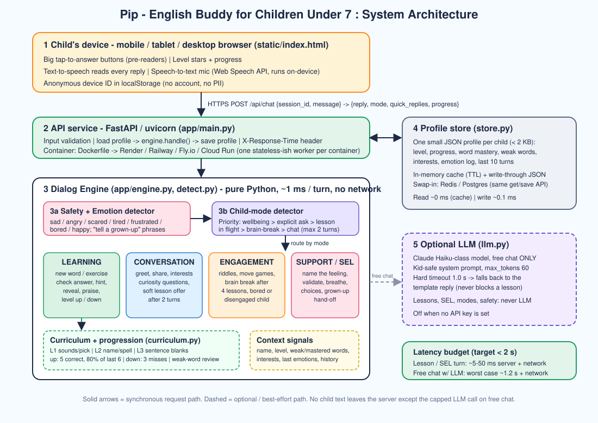
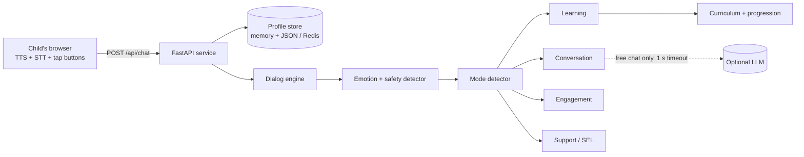

# Pip - English Buddy for Children Under 7
## System Design Document

---

## 1. Overview

Pip is a chatbot (a friendly parrot) that teaches English to children aged 4-6. It teaches in three levels, notices how the child is feeling and what they want to do, and only teaches when the child is ready. It remembers each child's progress and adapts to it.

**Design choice: hybrid, rules-first.** The core (lessons, modes, emotions, safety) is deterministic Python. An LLM is optional and only rephrases *free chat*. Reasons:

| Concern | Why rules-first wins for this audience |
|---|---|
| Latency (< 2 s) | Core turn takes ~0.1 ms (measured p99 0.16 ms). No model in the critical path. |
| Child safety | A model can never say something unplanned during a lesson, a feeling check-in, or a safety hand-off. |
| Pedagogy | Level rules, hints and review are explicit, testable and explainable to teachers/parents. |
| Cost / privacy | Works with zero external calls. Child text leaves the server only on capped free-chat calls, and only if a key is set. |
| Reliability | If the LLM is slow or down, the bot degrades to the template reply instead of failing. |

---

## 2. Requirements mapping

| Requirement | Where it is implemented |
|---|---|
| Progressive L1 / L2 / L3 | `curriculum.py` - word lists, exercise types per level, level-up / level-down rules |
| Child mode detection; not teaching every turn | `detect.py: detect_mode`, handlers in `engine.py` (4 modes, brain-break rule, 2-turn chat rule, "not now" respected) |
| Social-emotional learning | `detect.py` emotion lexicon, `engine._support`, growth-mindset praise, confidence reflection, curiosity prompts, feeling words as vocabulary, breathing exercise, grown-up hand-off |
| Context-aware responses | `models.Profile` (level, mastery, weak words, interests, emotion log, history, name); `next_exercise` and handlers read it |
| Latency < 2 s | Section 8 |
| Deliverables | Source (this repo), `docs/architecture.svg`, this document |

---

## 3. Architecture





**Request flow (one turn)**

1. Browser sends `{session_id, message}`. Children can tap a quick-reply button, type, or speak (browser speech-to-text, on-device).
2. API loads the child's `Profile` (cache hit, ~0 ms).
3. `Engine.handle`:
   1. `detect_safety` and `detect_emotion` on the text.
   2. `detect_mode` picks one of four modes (priority rules, section 4).
   3. The matching handler builds the reply, updates the profile (progress, weak words, counters).
4. If the reply is *free chat* and an LLM key exists, one short LLM call (hard timeout 1.0 s) may replace the template sentence. Lesson prompts and SEL text are never replaced.
5. Profile is saved; response returns reply, mode, emotion, quick replies, progress, latency.
6. Browser shows the reply, reads it aloud, and shows tap buttons.

---

## 4. Child mode detection

Four modes. The detector is a priority list, so the child's wellbeing and wishes always beat the lesson plan:

| Priority | Condition | Mode |
|---|---|---|
| 1 | Safety phrase, or sad / angry / scared / tired / frustrated | **SUPPORT** |
| 2 | Asks to breathe | **SUPPORT** |
| 3 | Bored, asks for game / riddle / joke, or 3 low-effort replies in a row | **ENGAGEMENT** |
| 4 | A riddle / move game is waiting for an answer | **ENGAGEMENT** |
| 5 | Asks to learn | **LEARNING** |
| 6 | Greeting or question about Pip | **CONVERSATION** (lesson stays pending) |
| 7 | "no", "not now", "stop", "bye" | **CONVERSATION** (always respected) |
| 8 | A lesson question is waiting for an answer | **LEARNING** |
| 9 | 4 lessons in a row | **ENGAGEMENT** (brain break) |
| 10 | Says yes after a lesson offer | **LEARNING** |
| 11 | Otherwise: chat for up to 2 turns, then offer a lesson | **CONVERSATION** → offer |

This is what stops Pip from "teaching in every interaction": a chat turn never starts a drill by itself; Pip *offers* ("Do you want to learn a new word?") and waits; four lessons in a row trigger a game; a "no" resets the offer counter.

**State machine (simplified)**

```
            +--------------- feeling hard / sad / tired ----------------+
            v                                                            |
 CONVERSATION --yes--> LEARNING --4 in a row--> ENGAGEMENT --learn--> LEARNING
     ^   |                 |  ^                      |
     |   +--sad etc.--> SUPPORT <--- 2 misses -------+
     |                       |
     +---- feels better -----+
```

**Edge cases handled:** a child answering the word "sad" in a feelings lesson is *not* treated as sad (emotion detection is skipped when the text is a correct answer); "not sad" is not sad; "ok / again / keep learning" while a question is pending re-asks the question instead of counting a wrong answer; abandoned games are dropped.

---

## 5. Progressive learning (L1 → L3)

| Level | Skill | Exercise types | Examples |
|---|---|---|---|
| **L1** | Recognise & say first words | *repeat* (hear + say), *pick* (tap one of two) | "This is a CAT 🐱. Say: cat" · "Which one is 🐶?" |
| **L2** | Name things & early spelling | *name* ("What is this?"), *spell* (missing letter) | "What is this? 🐟" · "🐦 Which letter is missing? B_RD" |
| **L3** | Short sentences | *cloze* (finish the sentence, two tap options) | "The 🐱 says ___ ." · "I feel ___ 😢 ." |

Word banks cover animals, colors, numbers, food, toys, nature **and feelings** (happy, sad, angry, scared) so emotional vocabulary is part of the curriculum.

**Progression rules** (`curriculum.record_result`):

- **Level up** after 5 correct answers *and* ≥ 80 % of the last 6 correct (prevents lucky streaks).
- **Level down** after 3 consecutive misses (prevents frustration spirals); Pip says "Let's make it easier".
- **Mastery:** a word is mastered after 2 correct answers; missed words enter a *weak list* and are re-selected with 40 % probability until mastered.
- **Scaffolding per question:** 1st wrong → encouragement + hint; 2nd wrong → reveal the answer warmly, log as weak, move on. Never a bare "wrong".
- **Typo tolerance:** edit-distance 1 on words of 4+ letters is accepted with a gentle spelling reminder (children can't spell yet).

---

## 6. Social & emotional learning (SEL)

SEL is part of the core loop, not an add-on:

| SEL skill | How Pip does it |
|---|---|
| **Emotional awareness** | Opens with "How do you feel today?" (tap 😊 😢 😠 😴). When a child expresses a feeling, Pip *names it as an English word* ("SAD 😢 is a feeling word"). |
| **Self-regulation** | Guided breathing ("smell the flower, blow the candle") on request and offered after distress; movement games. |
| **Confidence / growth mindset** | Praise targets effort ("I love how you kept trying"), mistakes are framed as brain-growing, hints before reveal, level-down instead of failure. Every 3rd correct answer: "How do you feel? Proud? 😊". |
| **Curiosity** | Open-ended wonder questions in chat ("What do you see around you?"), riddles, interest follow-ups. |
| **Positive learning behaviour** | Brain breaks, respecting "not now", check-in after repeated misses with a *choice* (breathe / play / keep learning), recovery acknowledged ("I am glad you feel better"). |
| **Safety** | Phrases about being hurt or unsafe trigger a fixed, calm hand-off to a trusted grown-up. The event is counted in `safety_flags` for a parent/teacher dashboard (not built). No LLM involved. |

Wording: ≤ 12-word sentences, concrete words, one emoji cluster, no sarcasm; every reply is read aloud by browser TTS.

---

## 7. Context awareness

The `Profile` (one small JSON object per child, anonymous device ID) is the memory:

| Field | Used for |
|---|---|
| `name` | Personal replies |
| `level`, `level_correct`, `recent` | Difficulty and level-up decision |
| `word_correct`, `weak`, `seen` | New-word vs review selection; mastery |
| `interests` (e.g. "animals", "dog") | Biases new words toward what the child likes (60 % when available) |
| `emotion_log`, `last_emotion`, `recovering` | Gentle re-entry after distress ("Let's try something easy"; "glad you feel better") |
| `lessons_in_row`, `chat_turns_in_row`, `low_engagement` | Mode switching (brain breaks, lesson offers, disengagement) |
| `pending` exercise | Chat mid-lesson, then return to the unanswered question; resume after page reload |
| `history` (last 10 turns) | Debugging / future analytics |

Progress persists across visits (write-through JSON in `DATA_DIR`).

---

## 8. Performance & the < 2 s requirement

| Step | Time |
|---|---|
| Network (client ↔ server) | 50-300 ms (deploy near users) |
| Validation, profile load/save | < 1 ms |
| Engine (detect + handler) | **0.07 ms p50 / 0.16 ms p99** (measured, 5 000 turns) |
| Optional LLM on free chat | **hard cap 1.0 s** (+0.1 s guard); fallback to template |

- **Lesson, SEL, engagement, safety turns:** ~ 5-350 ms end-to-end. No LLM, no blocking I/O.
- **Free-chat turn with LLM enabled:** worst case ≈ 1.1 s cap + network ≈ 1.5 s. Still < 2 s because the timeout is enforced with `asyncio.wait_for` and a single pooled `httpx` client (no TLS handshake per call). `max_tokens=60` keeps generation short.
- Browser TTS/STT run on the device, adding no server time.
- Every response carries `latency_ms` and an `X-Response-Time-ms` header, so the requirement can be monitored in production.
- Avoid free-tier cold starts (use an always-on instance or a keep-alive ping) - a cold container can add seconds regardless of code.

---

## 9. Data model

```text
Profile { session_id, name, level, mode, turn,
          greeted, awaiting_name, pending: Exercise?, attempts,
          lessons_in_row, chat_turns_in_row, low_engagement, recovering,
          recent[6], level_correct, wrong_streak, word_correct{}, weak{}, seen[],
          interests[], last_emotion, emotion_log[10], history[10], safety_flags }
Exercise { kind, word, prompt, answers[], options[], hint, level }
Reply    { text, mode, emotion, quick_replies[], suffix, llm_eligible }
```

**API**

```
POST /api/chat   {session_id, message}            -> {reply, mode, emotion, quick_replies[],
                                                       progress{level, level_correct, level_target, words_mastered},
                                                       llm_used, latency_ms}
GET  /health                                       -> {status, llm}
GET  /                                             -> chat UI
```
An empty `message` means "I just opened the app": first visit → greeting; returning child → welcome back / resume.

---

## 10. Safety, privacy, compliance

- **No accounts, no PII asked.** Only a first name (optional) and a random device ID. Pip never asks for address, school or contact details; the LLM system prompt forbids it.
- **Children's data:** if deployed beyond a demo, COPPA / GDPR-K apply: parental consent, data deletion endpoint, retention limit (`SESSION_TTL_SECONDS`), and no third-party analytics. The LLM call (optional) sends only the child's single message and level/interests, not the name's history.
- **Content safety:** all curriculum text is authored; the LLM is confined to 2 short sentences, with a "redirect to animals / colors / feelings" instruction, a length filter, and a fallback.
- **Input limits:** message ≤ 300 chars, session ID sanitised before use as a file name.

---

## 11. Deployment

- `Dockerfile` (python:3.12-slim, one uvicorn worker). Works on Render, Railway, Fly.io, Google Cloud Run, or any VPS.
- Environment: `PORT` (set by host), `DATA_DIR` (volume path for persistence, optional), `ANTHROPIC_API_KEY` (optional), `ANTHROPIC_MODEL`, `LLM_TIMEOUT_SECONDS`.
- Start command (no Docker): `uvicorn app.main:app --host 0.0.0.0 --port $PORT`.
- Health check: `GET /health`.

## 12. Scaling

- One turn costs ~0.1 ms CPU, so a single small instance handles hundreds of concurrent children.
- To scale out to many instances, replace `ProfileStore` with Redis (same `get` / `save` interface) or sticky sessions; profiles are < 2 KB.
- Long-term analytics: stream `history` events to a warehouse; build a parent / teacher dashboard from `word_correct`, `weak`, `emotion_log`, `safety_flags`.

## 13. Testing

`python -m unittest discover -s tests -t .` runs 19 tests covering: onboarding, all four modes reachable, "not always teaching", brain break, "no" respected, level up (capped at 3) and level down, hint → reveal → weak list, weak-word review probability, typo tolerance, emotion lexicon and negation, SEL replies, breathing, safety hand-off, recovery acknowledgement, interest personalisation, profile serialisation round-trip, and a per-turn speed check.

## 14. Limitations and future work

- Emotion detection is keyword-based: it misses sarcasm and spelling variants. A small on-device classifier, or voice-tone features, would improve recall.
- Speech-to-text from young children is noisy; a phonetics-aware matcher would help pronunciation checks (currently the transcript is compared as text).
- Content is a starter set (~26 words, 12 sentences) - the data structures scale to hundreds.
- No parent dashboard, adaptive spaced-repetition schedule across days, or multi-language support yet.
- Negation handling is minimal ("not sad"); full dependency parsing was judged unnecessary for ≤ 6-word child utterances.
